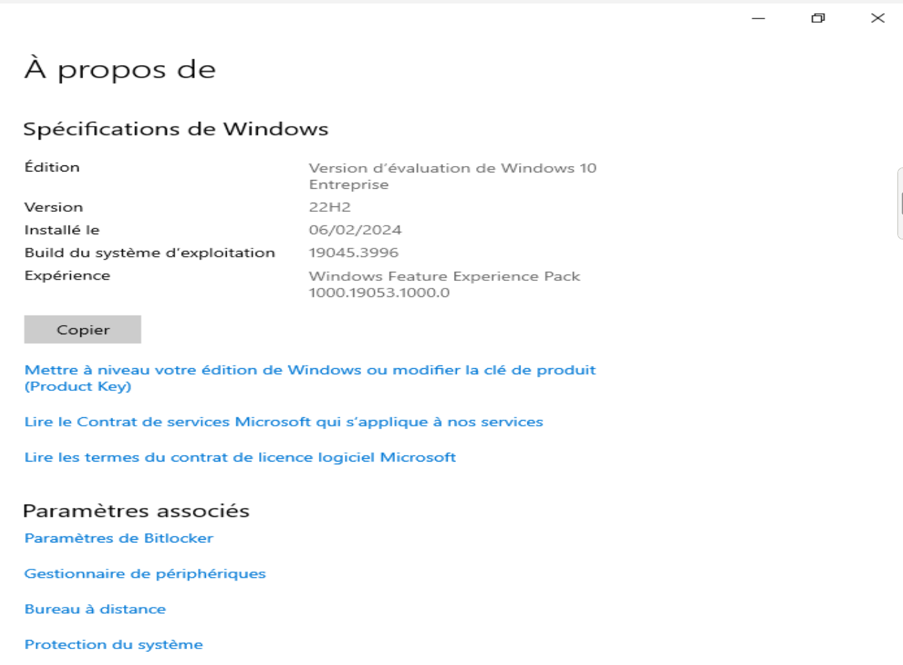
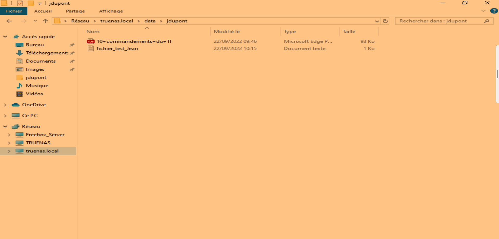

 # 🖥️ Assemblage et intégration d'un poste client en réseau local

## 📋 Contexte du projet
Dans le cadre de ma formation de **Technicien Informatique** (OpenClassrooms), j'ai conçu, assemblé et intégré un poste de travail complet dans le réseau local d'un client, en répondant à ses contraintes techniques, budgétaires et d'accessibilité.

---

## 🛠️ Configuration matérielle retenue (Devis : 3 408 € TTC)
* **Processeur :** Intel Core i7-12700K (3.6 GHz / 5.0 GHz – 12 cœurs)
* **Carte mère :** MSI MAG B760 TOMAHAWK WIFI DDR5
* **Mémoire vive (RAM) :** Textorm 32 Go (2x 16 Go) DDR5 4800 MHz
* **Stockage :** SSD NVMe Textorm BM40 M.2 PCIe 1 To
* **Carte graphique :** AMD Radeon Pro W5500 8 Go
* **Boîtier & Refroidissement :** Aerocool APNX C1 (Blanc) + Watercooling CPU + Lecteur/graveur DVD
* **Système d'exploitation :** Windows 10 Pro

---

## 🛡️ Comparatif des solutions Antivirus

| Antivirus | Prix annuel | Fonctionnalités principales | Compatibilité |
| :--- | :--- | :--- | :--- |
| **Bitdefender** | 49,99 € | Protection en temps réel, anti-phishing | Windows, Mac, iOS |
| **Kaspersky** | 39,99 € | Protection multicouche, VPN intégré | Windows, Mac, iOS |
| **Norton** | 49,99 € | Protection contre les ransomwares, VPN | Windows, Mac, iOS |

---

## 📸 Aperçu des réalisations techniques

### Validation du système d'exploitation (Windows 10 Pro)

### Intégration réseau et accès au NAS client

---

## 📂 Livrables complets du projet
* 📄 [Consulter le devis matériel complet (PDF)](Hocine_Bachir_1_Devis_022024.pdf)
* 🔌 [Consulter le schéma de la carte mère (PDF)](Hocine_Bachir_2_Schema_022024.pdf)
* 🛡️ [Consulter l'étude comparative des antivirus (PDF)](Hocine_Bachir_5_Antivirus_022024.pdf)
